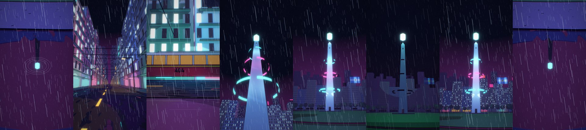

# procedural-anime

Vertical anime-style shorts (cel-shading, ink line art, flat color, neon) built **entirely from
code**: Blender 5.2 driven headless from Python, plus a soundtrack synthesized from scratch.
No image or video generation model, no recorded samples.



*NODO 404: a 34 s seamless loop set at the Obelisco in Buenos Aires. A blackout cascades
through the city, a hexagonal crystal pulses in the dark, then everything lights back up.
[Watch it on YouTube](https://youtube.com/shorts/0enpupe-v6Y).*

## What is in here

- **`motor/`** — the engine. `escena.py` reads a shot description (a JSON file) and builds the
  scene in Blender; `post.py` does the 2D compositing (glow, rain, grain, glitch); `montaje.py`
  stitches the shots and mixes the audio; `audio/dsp.py` has the synthesis primitives.
- **`episodios/nodo_404/`** — a complete example episode: six shots as JSON, a hand-written
  score (`banda.py`) and the timeline. It is also the template for new episodes.
- **`episodios/el_relojero/`** — a mechanical short story: an old robot keeps the clock of the
  San Isidro cathedral running; when a pinion breaks, his heart turns out to be the missing
  part. Real gear trains (`motor/piezas/mecanica.py`, checked with `motor/engrane.py`), arm and
  leg IK, assembly from a pile of spare parts, a loop with a 0.0 seam and a score built around
  the clock tick. [Watch it on YouTube](https://youtube.com/shorts/QHXfY1VOAr0).
- **`docs/PRODUCCION.md`** — everything learned the hard way: the look, wet-floor reflections,
  blackout animation, GPU performance on a 2 GB card, Blender 5.2 pitfalls, sound design.
- **`AGENTS.md`** — the same map written for a coding agent, with the full JSON reference.

> The documentation is in Spanish (it was written that way), the code identifiers are mixed.

## The ideas worth stealing

- **A shot is a text file.** Camera, lights, buildings, events and post effects live in a JSON
  that can be diffed, inherited (`extends`) and generated. Nothing binary is versioned.
- **Cel for form, airbrush for light.** A constant color ramp over luminance gives hard toon
  shading, but an emissive glow looks banded that way. The engine adds soft analytic glows on
  top of the cel, as hand-painted anime backgrounds do.
- **Everything that emits is driven by one per-object `power` property**, so a blackout
  cascade is just keyframes on a number, even when materials are shared.
- **Deterministic post.** No per-frame randomness: rain, grain and glitch are pure functions of
  the frame number, so re-rendering reproduces the file.
- **Sound anchored to picture.** Every sound event is placed by (shot, frame); change a shot's
  length and the score follows. The script prints the loudness curve so you can check the
  dramaturgy instead of guessing.
- **Look at every frame.** Draft and single-frame render modes exist so you can iterate in
  seconds and only render a full shot once the look is approved.

## Quick start

Requirements: Blender 5.2, Python 3.13, `ffmpeg` on the PATH.

```bash
pip install -r requirements.txt

# a few test frames of one shot, with a contact sheet in episodios/nodo_404/out/
python motor/render.py episodios/nodo_404 06_apagon --frames 1 40 66 --draft

# a full shot (Blender + post)
python motor/render.py episodios/nodo_404 06_apagon

# soundtrack, then the final cut with sound
python episodios/nodo_404/banda.py
python motor/montaje.py episodios/nodo_404
```

If Blender is not found, set the `BLENDER` environment variable to its executable.
Developed and tested on Windows only.

## Honest limits

- **Pre-rendered, not real time.** Each frame takes around 2 s on a modest 2 GB GPU; this makes shorts and
  cutscenes, not something interactive.
- **No faces, no characters.** The method is at its best with cities, light, rain, architecture
  and machines. Expressive characters are the weak spot.
- **Tuned for one machine.** The render profile (`PERF` in `motor/piezas/mundo.py`) targets a
  2 GB GPU; a bigger card can afford more.

## License

[MIT](LICENSE)
